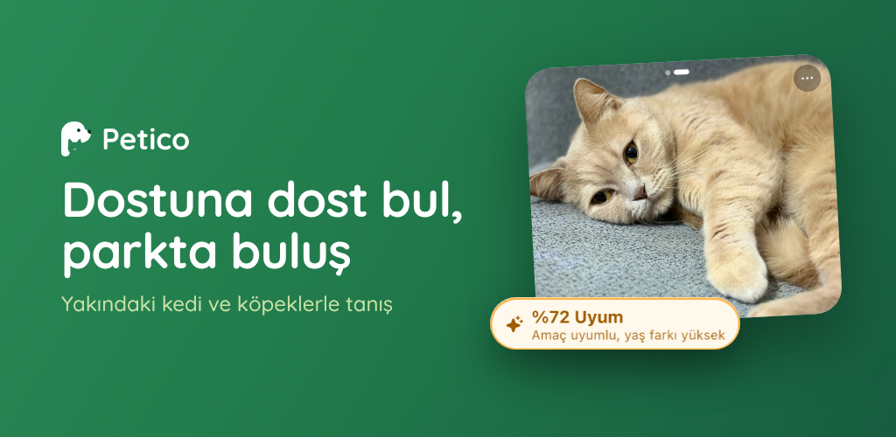
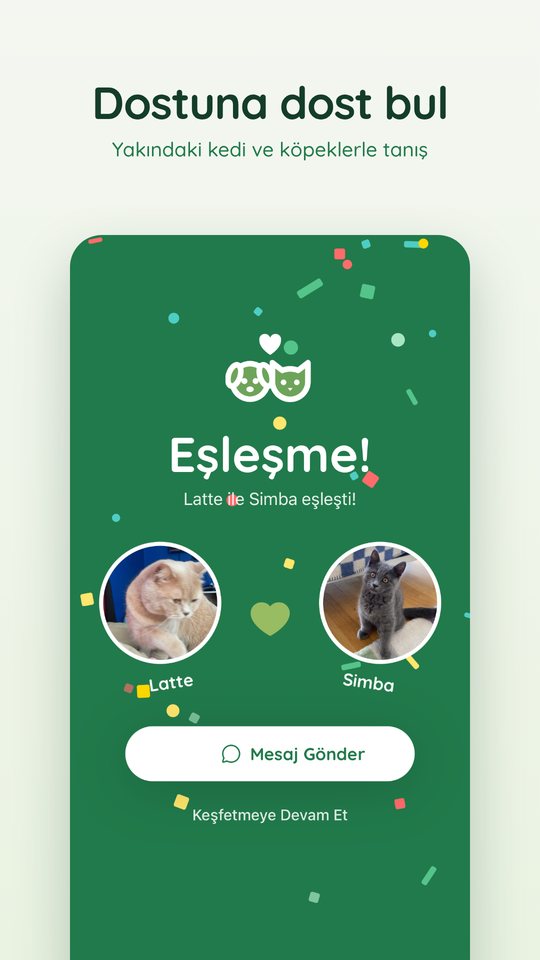
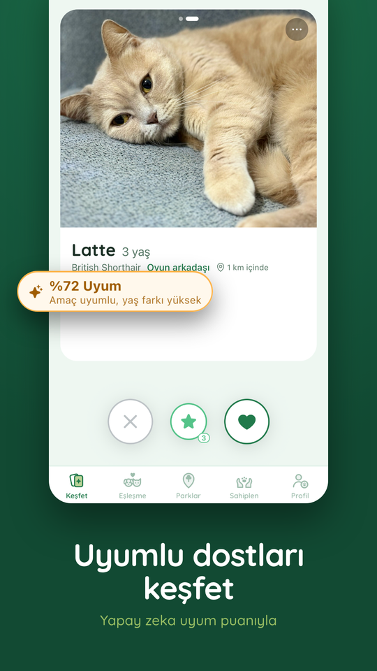
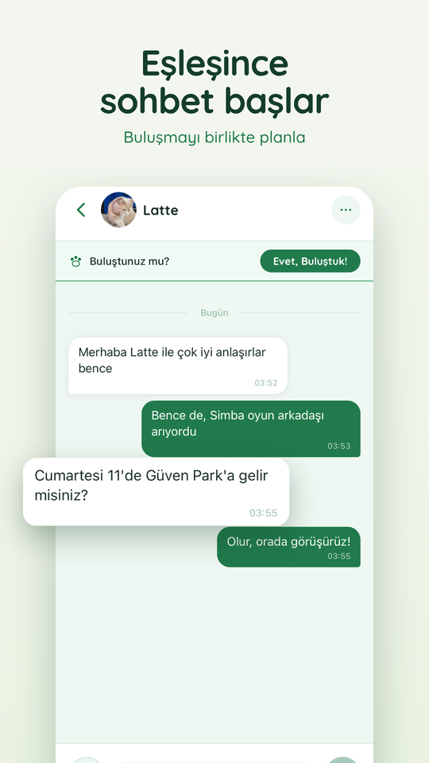
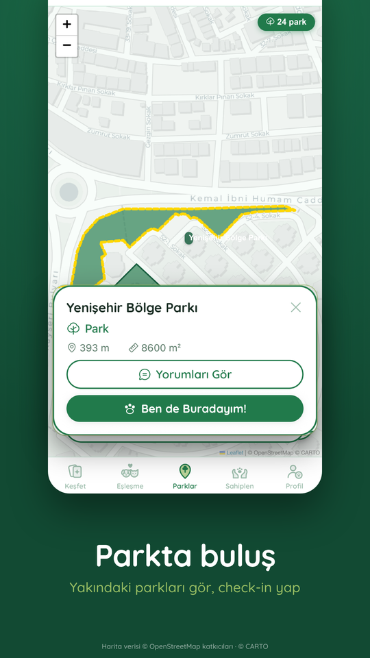
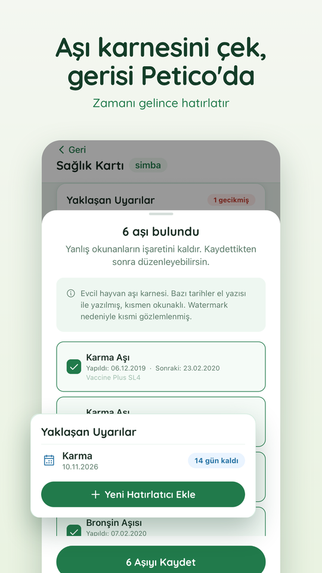
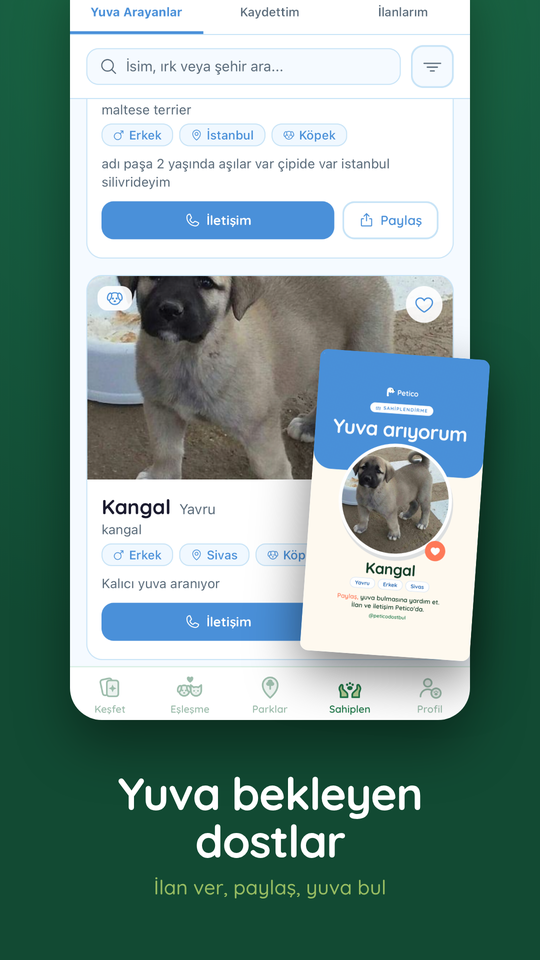
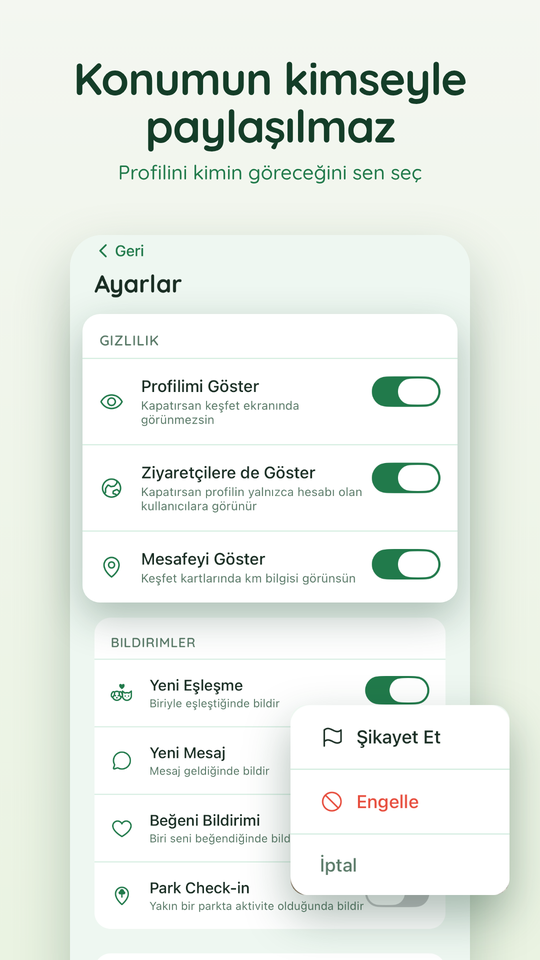

  

# Petico · Dostuna dost bul

Evcil hayvanları yakınlarındaki uyumlu dostlarıyla buluşturan mobil uygulama. Yapay zeka iki hayvanın profilini karşılaştırıp bir uyum puanı çıkarır; eşleşen sahipler sohbet edip parkta buluşur. Uygulamayı fikirden mağaza yayınına kadar tek başıma geliştirdim.

**[App Store](https://apps.apple.com/tr/app/petico-dost-bul/id6784002596) · [Google Play](https://play.google.com/store/apps/details?id=com.berkaycongar.petico) · [İndirme sayfası](https://berkaycongarr.github.io/peticodostbul/)**

> **In English:** Petico is a pet matching app for iOS and Android, live on the App Store and Google Play. An AI compatibility score compares two pet profiles; matched owners chat and meet at nearby parks. The app also keeps a health card that reads vaccine records from a photo, and lists pets waiting for a home across Türkiye's 81 provinces. I built it solo, from idea to store release, with React Native (Expo), TypeScript and Supabase. The source code is private, so this repository is a showcase; I'm happy to walk through the code on a screen share. The app and the screenshots are in Turkish.

## Ekranlar

  
  
  
  

  
  
  

## Neler var

- **Yapay zeka uyum puanı:** İki hayvanın profilini karşılaştırır, yüzdelik bir uyum puanı ve kısa bir gerekçe gösterir.
- **Eşleşme ve sohbet:** Eşleşen hayvanların sahipleri uygulama içinde mesajlaşır ve buluşmayı planlar. Yeni eşleşme ve mesajlar push bildirimiyle gelir.
- **Parklar:** Yakındaki parklar haritada görünür; check-in yapılabilir, yorumlar okunabilir.
- **Sağlık kartı:** Aşı karnesinin fotoğrafından aşılar yapay zekayla okunur, yaklaşan aşılar için hatırlatıcı kurulur.
- **Sahiplendirme:** 81 ilde yuva arayan hayvanlar için ilan verilir ve paylaşılır.
- **Gizlilik ve güvenlik:** Tam konum kimseyle paylaşılmaz, profili kimin göreceğini kullanıcı seçer. Şikayet ve engelleme vardır.

## Nasıl yapıldı

- **Uygulama:** React Native (Expo SDK 57), TypeScript ve Expo Router. iOS ve Android tek kod tabanından çıkar.
- **Backend:** Supabase üzerinde PostgreSQL, kimlik doğrulama ve Edge Functions. Her tabloda Row Level Security var.
- **Yapay zeka maliyeti:** Uyum puanı bir LLM API ile üretilir. Puan önbelleği, kullanıcı başına günlük limit ve yükleme anında görsel denetimi tekrarlı model çağrılarını kaldırır, API maliyetini öngörülebilir tutar.
- **Konum gizliliği:** Mesafeler sunucuda hesaplanır, kullanıcıların tam konumu istemciye hiç ulaşmaz.
- **Bildirimler:** Push bildirimleri sunucu tarafında yetkilendirilir.
- **Bakım:** Expo SDK 54'ten 57'ye adım adım yükseltildi.
- **Yayın:** İki mağazanın yayın sürecini yönetiyorum. App Store'un kullanıcı üretimli içerik reddini (Guideline 1.2) EULA onay akışıyla çözdüm.
- **Büyüme:** Mağaza görselleri, dört haftalık içerik takvimi, Instagram ve TikTok hesapları.

## Yol

- **Mart 2026:** Bitirme projesi olarak başladı.
- **Ekim 2026:** Habitat Derneği ve UNICEF Türkiye'nin Genç Girişimciler Fikir Maratonu'na seçildi; Teknopark İstanbul'un HASAT hızlandırma programına davet edildi.

## Kaynak kod

Kaynak kod gizli, bu depo bir vitrin. Kodu ekran paylaşımıyla adım adım gösterebilirim.

## Lisans

Görseller ve metinler tüm hakları saklı olarak paylaşılmıştır.

*All rights reserved. The screenshots and text are shared as a portfolio piece.*

Berkay Çongar · congarberkay@gmail.com · [LinkedIn](https://linkedin.com/in/berkaycongar)
